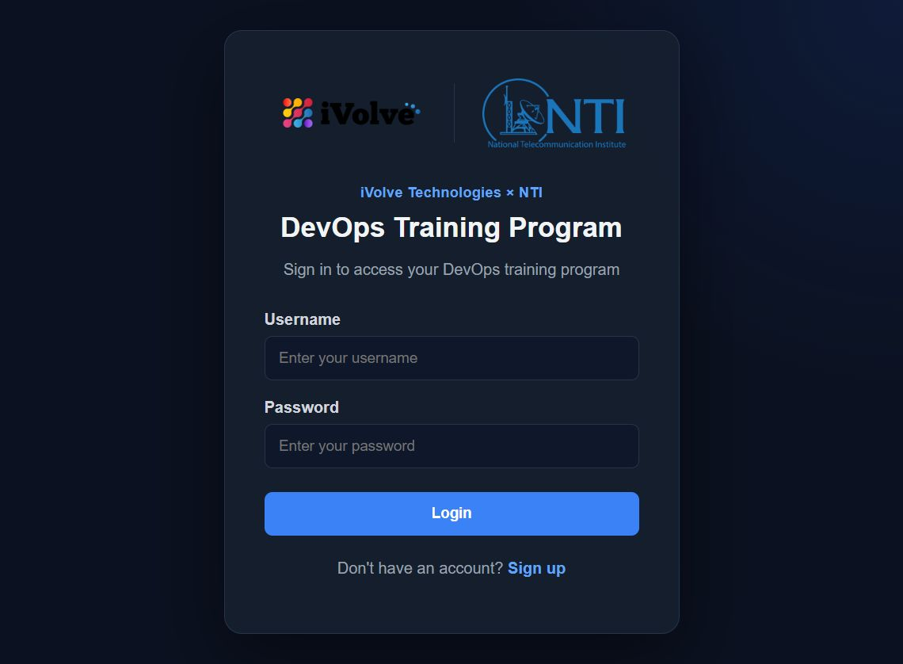
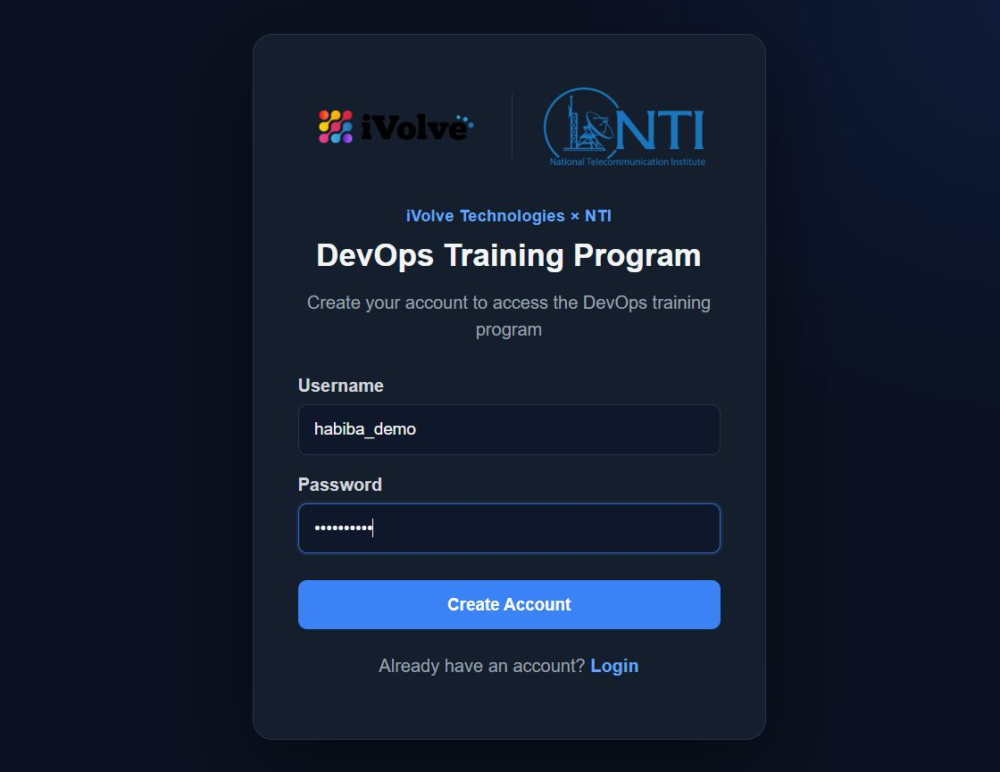
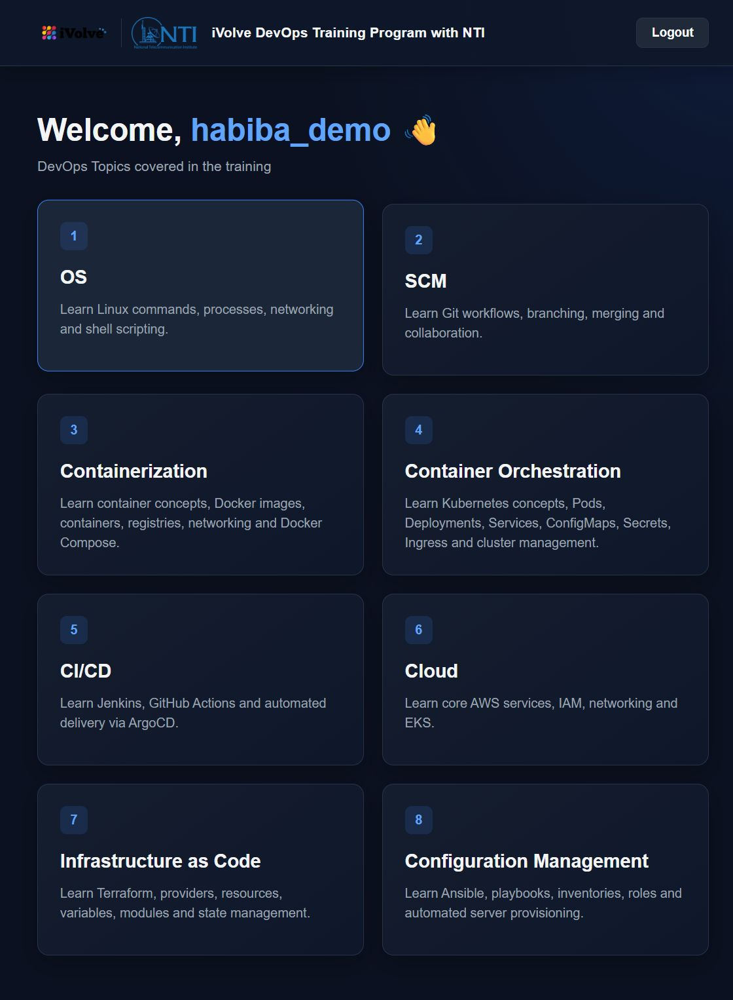

# CloudDevOpsProject


End-to-end DevOps delivery of the NTI × iVolve microservices application:

**Docker → Terraform → Ansible → Kubernetes (EKS) → Jenkins CI → ArgoCD (GitOps)**

The whole platform can run **fully offline** against [Floci](https://github.com/floci-io/floci), an AWS
emulator that provides EC2, EKS (k3s), ECR, S3, IAM and STS on `localhost:4566`. No AWS account and
no cloud spend are required.

---

## 1. Application

| Service | Stack | Port | Responsibility |
| --- | --- | --- | --- |
| `frontend` | Node.js / Express / EJS | 3000 | UI, sessions, calls the two backend services |
| `auth-service` | Python / Flask + MySQL connector | 5000 | Signup, login, `/health` DB check |
| `roadmap-service` | Java 21 / Spring Boot | 8080 | Serves the DevOps roadmap JSON |
| `mysql` | MySQL 8.0 | 3306 | Users table (`ivolve` database) |

```text
Browser
   │  HTTP :80 (Ingress)
   ▼
frontend :3000 ──► auth-service :5000 ──► mysql :3306
   │
   └────────────► roadmap-service :8080
```

The original app code is intentionally untouched: this repository adds the delivery platform
around it (Compose, Terraform, Ansible, Kubernetes, Jenkins, ArgoCD, docs).

### Application screens

| Sign in | Sign up | Roadmap |
| --- | --- | --- |
|  |  |  |

---

## 2. Repository layout

```text
.
├── docker-compose.yml            # local app stack (4 services + MySQL)
├── .env.example                  # ports / DB / session variables
├── terraform/
│   ├── modules/
│   │   ├── network/              # VPC, 2 public + 2 private subnets, IGW, NAT, NACLs, route tables
│   │   ├── server/               # Jenkins EC2, security group, key pair, IAM instance profile
│   │   ├── eks/                  # EKS cluster + 2 managed node groups (one per private subnet/AZ)
│   │   └── ecr/                  # 3 repositories + scan-on-push + lifecycle policy
│   ├── backend/                  # S3 state bucket bootstrap
│   └── environments/
│       ├── local/                # Floci endpoints + S3 backend
│       └── prod/                 # real AWS
├── ansible/                      # Jenkins server configuration (roles: common, java, docker, jenkins, trivy)
├── k8s/
│   ├── base/                     # namespace, config, secret, storage class, MySQL STS, 3 deployments, ingress
│   └── overlays/{local,prod}/    # Kustomize overlays (storage, ingress class, replicas, ECR images)
├── jenkins/
│   ├── shared-library/vars/      # buildImage, trivyScan, ecrLogin, pushImage, cleanupImage, updateManifests
│   ├── pipelines/                # one Jenkinsfile per microservice
│   └── README.md
├── argocd/                       # AppProject, Applications, Helm values
├── platform/                     # local lab: Floci + Gitea + Jenkins image/Compose, SSH keys
└── docs/
    ├── architecture.md
    ├── setup.md                  # production (real AWS) runbook
    └── local-lab.md              # Floci-only, offline runbook
```

---

## 3. Quick start — local application (Docker Compose)

```bash
cp .env.example .env
docker compose up -d --build
docker compose ps
```

Open <http://localhost:3000>, sign up, log in, and the roadmap page is displayed.
`curl http://localhost:5000/health` returns `{"status":"UP","database":"connected"}`.

Ports are configurable in `.env`
(`FRONTEND_HOST_PORT`, `AUTH_HOST_PORT`, `ROADMAP_HOST_PORT`, `MYSQL_HOST_PORT`).

---

## 4. CI/CD flow

```text
 git push ──► Jenkins (EC2, provisioned by Ansible)
                │  1. checkout
                │  2. docker build (shared library: buildImage)
                │  3. trivy image scan, fail on HIGH/CRITICAL (trivyScan)
                │  4. docker login to ECR (ecrLogin)
                │  5. docker push (pushImage)
                │  6. docker rmi local image (cleanupImage)
                │  7. bump image tag in k8s/overlays/prod (updateManifests)
                ▼
             Git repository
                │
                ▼
             ArgoCD ──► EKS: rolling update, prune, self-heal
```

* The three pipelines live in `jenkins/pipelines/*.Jenkinsfile` and only differ by service name.
* The shared library is declared with `@Library('ivolve-shared-library') _`.
* Image promotion is a Git commit — ArgoCD, not Jenkins, performs the deployment.

Details and credential setup: [`jenkins/README.md`](jenkins/README.md).

---

## 5. Infrastructure (Terraform)

Two environments share the same modules:

| Environment | Provider | Backend | Purpose |
| --- | --- | --- | --- |
| `local` | Floci (`localhost:4566`) | S3 bucket in Floci | offline demo |
| `prod` | real AWS | S3 + native lockfile | real deployment |

* State is stored in S3 with `use_lockfile = true` (Terraform ≥ 1.10, no DynamoDB).
* EKS gets **two managed node groups** in two private subnets/AZs (2 worker nodes).
* Jenkins runs as an EC2 instance in a public subnet, with an IAM instance profile that can push to ECR.
* Private workloads reach the internet through a single NAT gateway; public subnets host the ALB/NAT.

```bash
cd terraform/environments/local
cp terraform.tfvars.example terraform.tfvars
terraform init && terraform apply
```

Production: see [`docs/setup.md`](docs/setup.md).

---

## 6. Kubernetes & GitOps

* Namespace `ivolve`, MySQL **StatefulSet** with a headless Service and a PVC.
* Deployments for the three services with readiness + startup + liveness probes and resource limits.
* `ivolve.local` Ingress (Traefik in the local lab, NGINX in production).
* Kustomize overlays keep environment differences out of the base.
* ArgoCD `Application` points at `k8s/overlays/prod` on `main`, with automated sync, prune and self-heal.

```bash
kubectl kustomize k8s/overlays/prod        # render
kubectl apply -k k8s/overlays/prod         # or let ArgoCD do it
kubectl apply -k argocd                    # project + application (after ArgoCD is installed)
```

---

## 7. Ansible

`ansible/playbook.yml` configures the Jenkins EC2 instance:

* `common` – base packages, admin user, passwordless sudo
* `java` – OpenJDK 21 (required by Jenkins LTS)
* `docker` – Docker Engine + Compose plugin, users in the `docker` group
* `jenkins` – official apt repository, port/JVM override, wait for UI, initial admin password
* `trivy` – official apt repository

```bash
cd ansible
ansible-galaxy collection install -r requirements.yml
ansible-playbook playbook.yml            # dynamic inventory (tag: ivolve-jenkins)
ansible-playbook -i inventory/local.ini playbook.yml   # Floci lab instance
```

---

## 8. Documentation

* [`docs/architecture.md`](docs/architecture.md) – components, networking, data and deployment flows, decisions.
* [`docs/setup.md`](docs/setup.md) – production setup from zero (AWS, Terraform, Ansible, Jenkins, ArgoCD).
* [`docs/local-lab.md`](docs/local-lab.md) – the fully local Floci lab, including known limitations.
* [`jenkins/README.md`](jenkins/README.md) – shared library API, credentials, jobs.

---

## 9. Notes & limitations

* **Floci is an emulator.** ECR is a real registry, EC2 instances are real containers, and EKS is a real
  k3s cluster, but IAM/S3 behaviours are simplified. Two node groups are created for the two private
  subnets, yet Floci schedules them onto a single shared k3s node.
* Workstations with less than 12 GB RAM may need to run the CI stack and the full cluster in
  separate sessions; the lab runbook explains which parts to run together.
* Secrets in `k8s/base/secret.yaml` are demo values. Replace them with a real secret manager in
  production (the RBAC/IAM wiring is already in place).
